# Wrist camera task response diagnostic

Status: **COMPLETE**

Single eight-step chunks. Task flags describe short chunks; no full-rollout success rate or CASR is estimated.

| Model | Completed | Invalid | Missing |
|---|---:|---:|---:|
| base | 93 | 6 | 0 |
| consistency_w1_s42 | 93 | 6 | 0 |
| consistency_w10_s42 | 93 | 6 | 0 |

Physical response is approach to the actual simulator target. Interactions subtract the paired base response.
Absolute branch distances, approach, displacement, contact/grasp flags and invalid reasons: [BRANCHES.csv](BRANCHES.csv).
Video export status: COMPLETE. Export errors are separate from experiment completeness.
Each estimate uses complete condition pairs in every model. Signs are reported separately. Task denominators and task→trajectory bootstrap intervals are in SUMMARY.json.

| Physical approach interaction | Mean (m) | 95% interval (m) | Paired trajectories |
|---|---:|---|---:|
| physical/target_minus_camera_minus/consistency_w10_s42/approach_m/interaction_vs_base | 0.000278 | [-8.428539524675364e-06, 0.0006872455430574442] | 10 |
| physical/target_minus_camera_minus/consistency_w1_s42/approach_m/interaction_vs_base | 0.000084 | [-9.444817828626814e-06, 0.00019104988258789203] | 10 |
| physical/target_minus_camera_plus/consistency_w10_s42/approach_m/interaction_vs_base | 0.000173 | [-0.00015845481835777015, 0.0004716976812120645] | 10 |
| physical/target_minus_camera_plus/consistency_w1_s42/approach_m/interaction_vs_base | 0.000096 | [-0.00010125035856776917, 0.000305977901025658] | 10 |
| physical/target_minus_camera_zero/consistency_w10_s42/approach_m/interaction_vs_base | -0.000029 | [-0.00030822924730908123, 0.00026288962185006166] | 10 |
| physical/target_minus_camera_zero/consistency_w1_s42/approach_m/interaction_vs_base | -0.000377 | [-0.0009786156444159485, -9.2760658769106e-06] | 10 |
| physical/target_plus_camera_minus/consistency_w10_s42/approach_m/interaction_vs_base | 0.000122 | [-8.041479576996729e-05, 0.0004095780202519957] | 10 |
| physical/target_plus_camera_minus/consistency_w1_s42/approach_m/interaction_vs_base | 0.000010 | [-8.427363928781685e-05, 0.00010430295698128539] | 10 |
| physical/target_plus_camera_plus/consistency_w10_s42/approach_m/interaction_vs_base | 0.000125 | [-0.00010051758953073605, 0.0004071299975085662] | 10 |
| physical/target_plus_camera_plus/consistency_w1_s42/approach_m/interaction_vs_base | 0.000165 | [1.3222659762125808e-05, 0.00030115489189901784] | 10 |
| physical/target_plus_camera_zero/consistency_w10_s42/approach_m/interaction_vs_base | 0.000023 | [-5.195858438063498e-05, 8.784093960232395e-05] | 10 |
| physical/target_plus_camera_zero/consistency_w1_s42/approach_m/interaction_vs_base | -0.000159 | [-0.0005311411544433426, 5.988832813535929e-05] | 10 |

| Model/task | Completed / expected | Invalid | Missing | Contact / denominator | Grasp / denominator |
|---|---:|---:|---:|---:|---:|
| base/libero_10/t0 | 9/9 | 0 | 0 | 0/9 | 0/9 |
| consistency_w1_s42/libero_10/t0 | 9/9 | 0 | 0 | 0/9 | 0/9 |
| consistency_w10_s42/libero_10/t0 | 9/9 | 0 | 0 | 0/9 | 0/9 |
| base/libero_goal/t1 | 15/18 | 3 | 0 | 6/15 | 0/15 |
| consistency_w1_s42/libero_goal/t1 | 15/18 | 3 | 0 | 6/15 | 0/15 |
| consistency_w10_s42/libero_goal/t1 | 15/18 | 3 | 0 | 6/15 | 0/15 |
| base/libero_object/t0 | 18/18 | 0 | 0 | 1/18 | 0/18 |
| consistency_w1_s42/libero_object/t0 | 18/18 | 0 | 0 | 0/18 | 0/18 |
| consistency_w10_s42/libero_object/t0 | 18/18 | 0 | 0 | 0/18 | 0/18 |
| base/libero_object/t1 | 18/18 | 0 | 0 | 8/18 | 7/18 |
| consistency_w1_s42/libero_object/t1 | 18/18 | 0 | 0 | 8/18 | 7/18 |
| consistency_w10_s42/libero_object/t1 | 18/18 | 0 | 0 | 8/18 | 7/18 |
| base/libero_spatial/t0 | 15/18 | 3 | 0 | 7/15 | 0/15 |
| consistency_w1_s42/libero_spatial/t0 | 15/18 | 3 | 0 | 6/15 | 0/15 |
| consistency_w10_s42/libero_spatial/t0 | 15/18 | 3 | 0 | 8/15 | 0/15 |
| base/libero_spatial/t1 | 18/18 | 0 | 0 | 4/18 | 0/18 |
| consistency_w1_s42/libero_spatial/t1 | 18/18 | 0 | 0 | 5/18 | 0/18 |
| consistency_w10_s42/libero_spatial/t1 | 18/18 | 0 | 0 | 5/18 | 0/18 |

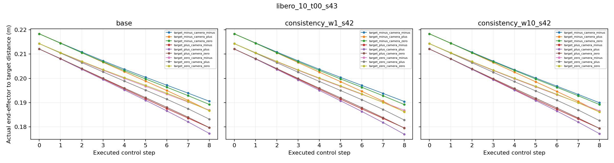

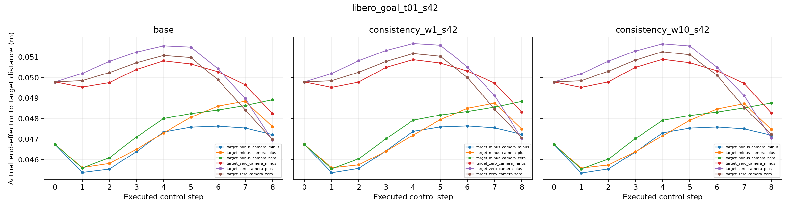

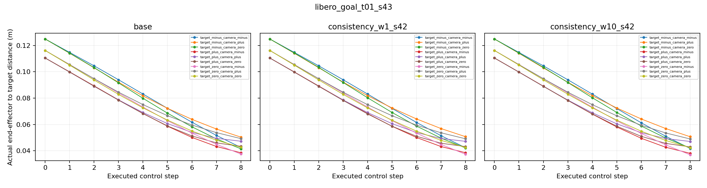

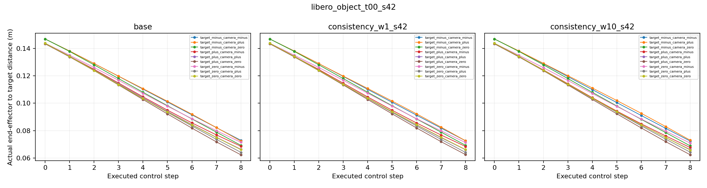

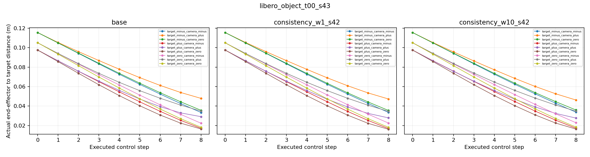

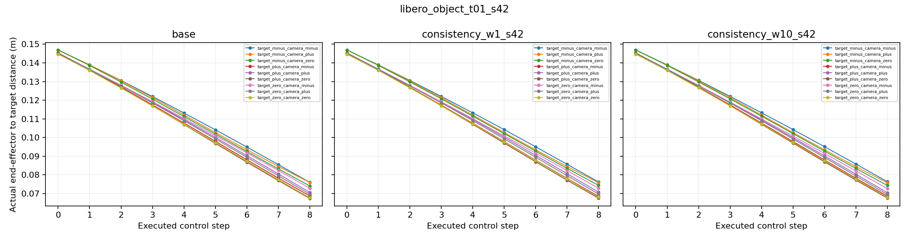

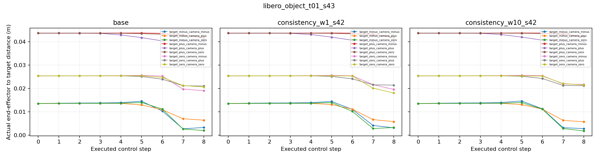

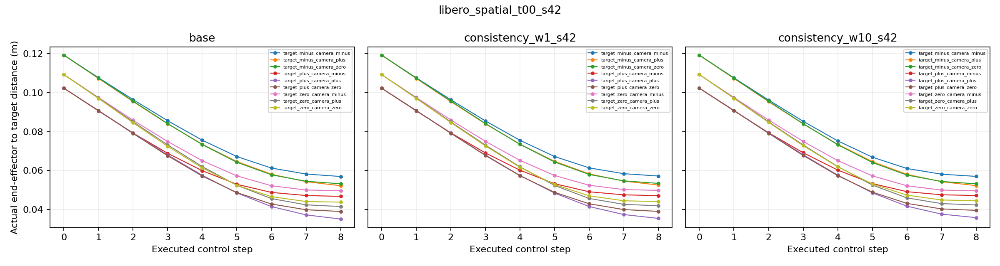

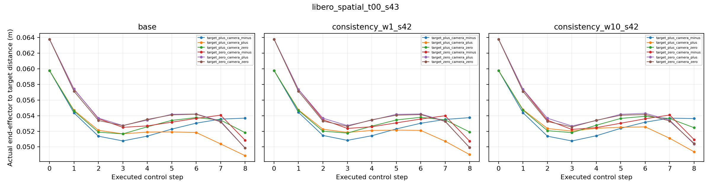

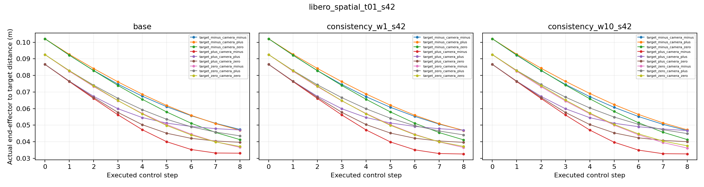

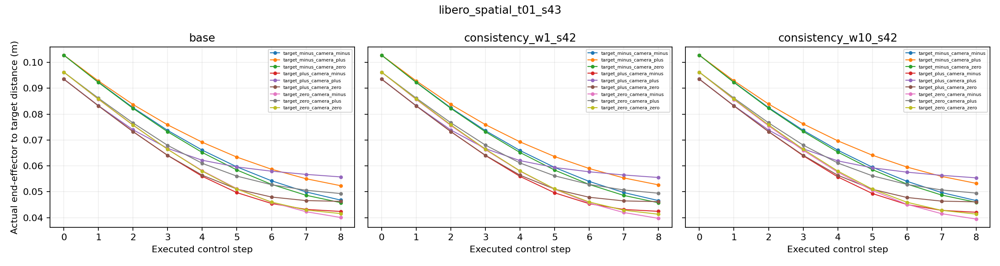
