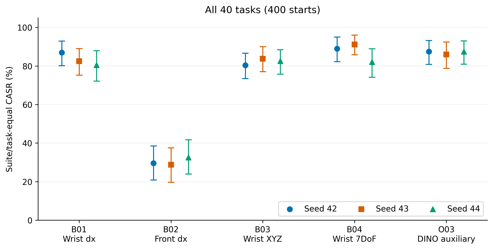
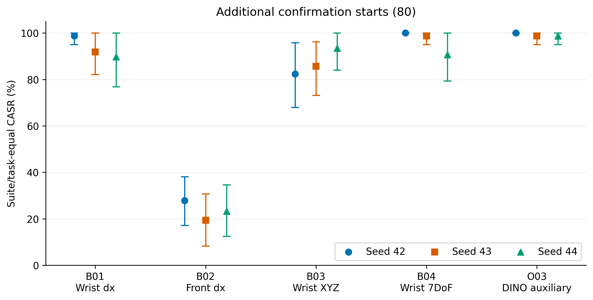
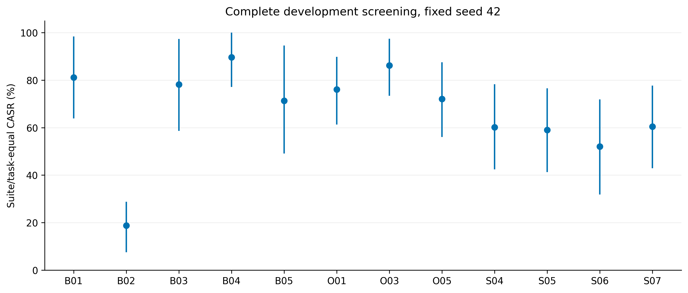
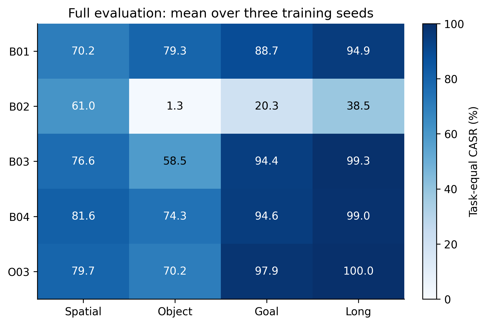
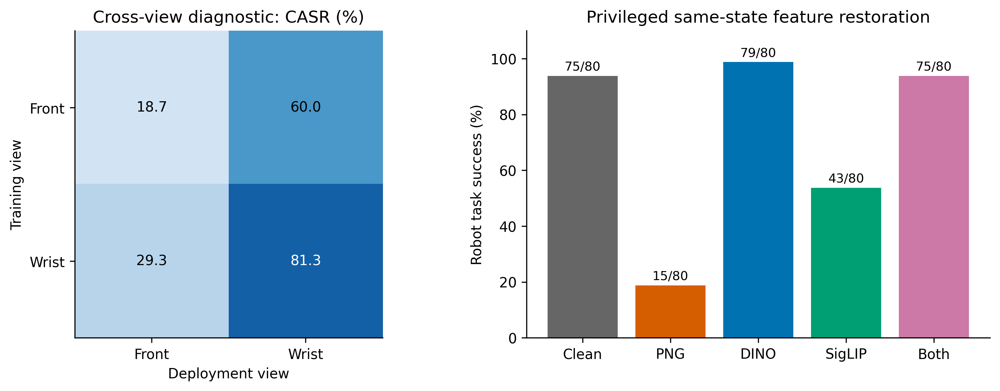
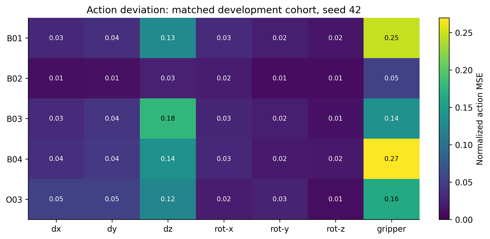
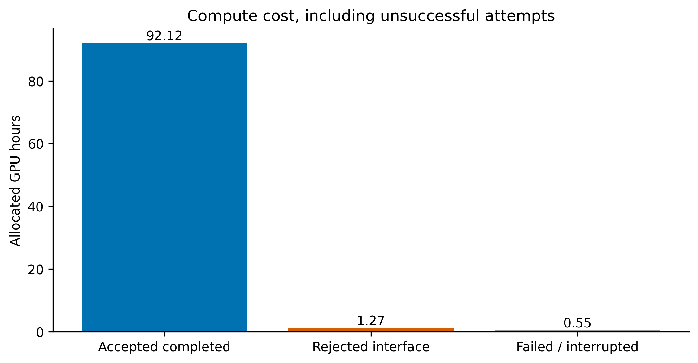

# Final recorded-result figures

Every figure has PNG, PDF, and exact data/source hashes in its .data.json file. Preview output does not complete V03.

## full_casr_by_seed

Each fixed training seed is separate. Whiskers are existing task-to-start bootstrap 95% intervals; no frames or action slots are independent samples.

## confirmation_extra_casr_by_seed

Each fixed training seed is separate. Whiskers are existing task-to-start bootstrap 95% intervals; no frames or action slots are independent samples.

## development_screening_seed42

All completed seed42 performance arms are retained, including negative results. The 16-start initialization smoke test is a different cohort and is excluded.

## full_suite_heatmap

Within each suite, tasks are equally weighted. Cells average all three fixed training seeds; undefined values remain NA.

## view_and_branch_diagnostics

Seed42 matched 80-start development cohort. Left: cross-view diagnostic. Right: clean same-state feature donors are privileged mechanism probes, separate from deployable PNG scores. Only the accepted float32 M02 revision is used.

## action_error_by_dimension

Existing M03 errors include all eight predicted slots, not only executed slots. Episode-level errors are averaged within task, then suite, then across suites. Action commands are not physical displacement distances.

## gpu_costs

Slurm allocation time is preferred, including startup failures before CUDA initialized. Explicitly labelled process-time fallback is retained in GPU_COST.csv. CPU-only allocation contributes zero GPU hours; this is allocation time, not measured GPU utilization.

